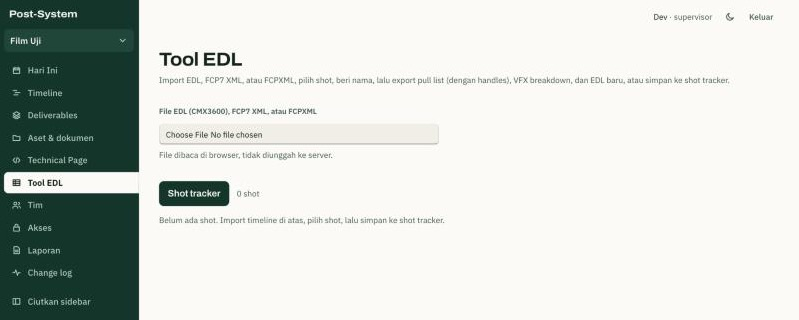
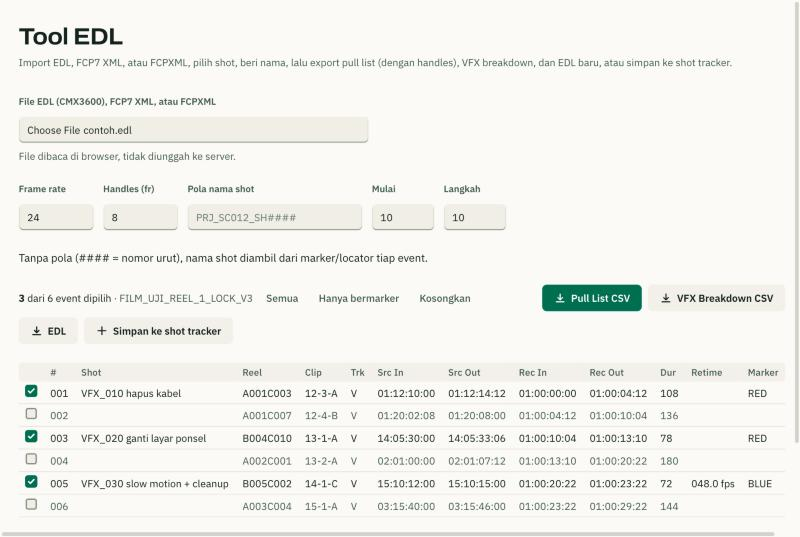
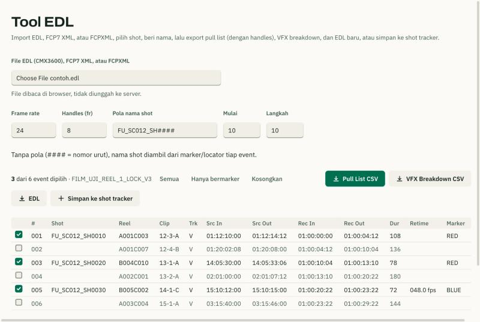
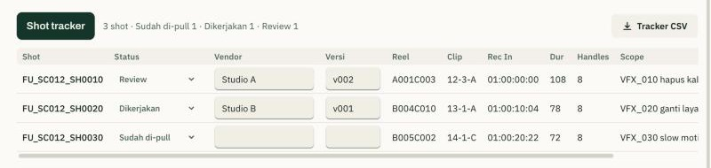
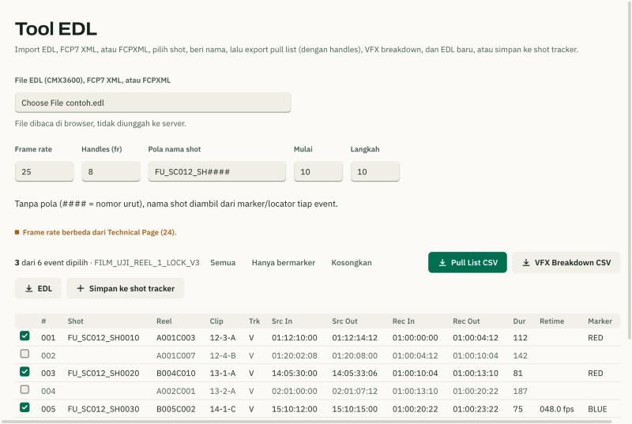

# Tool EDL — Panduan Penggunaan

Tool EDL mengubah timeline editorial (EDL, FCP7 XML, atau FCPXML) menjadi daftar shot, lalu menghasilkan
pull list, VFX breakdown, dan EDL baru. Shot yang dipilih bisa disimpan ke **shot tracker** untuk dilacak
status, vendor, dan versinya.

Panduan ini memakai file contoh [`tool-edl/contoh.edl`](tool-edl/contoh.edl) (6 event, 3 di antaranya
bermarker VFX). Anda bisa mengunduhnya dan mengikuti langkah-langkahnya di project sendiri.

## Daftar isi

1. [Membuka tool](#1-membuka-tool)
2. [Menyiapkan file dari NLE](#2-menyiapkan-file-dari-nle)
3. [Import file](#3-import-file)
4. [Membaca tabel event](#4-membaca-tabel-event)
5. [Memilih shot](#5-memilih-shot)
6. [Frame rate dan handles](#6-frame-rate-dan-handles)
7. [Memberi nama shot](#7-memberi-nama-shot)
8. [Export](#8-export)
9. [Shot tracker](#9-shot-tracker)
10. [Import cut baru](#10-import-cut-baru)
11. [Hak akses](#11-hak-akses)
12. [Peringatan dan pesan error](#12-peringatan-dan-pesan-error)
13. [Batasan saat ini](#13-batasan-saat-ini)

---

## 1. Membuka tool

Buka project, lalu pilih **Tool EDL** di sidebar.



Halaman ini punya dua bagian:

- **Atas — tool**: tempat import file, pengaturan, dan export.
- **Bawah — shot tracker**: daftar shot yang sudah disimpan untuk project ini.

File dibaca langsung di browser. Isi file **tidak diunggah ke server**; yang tersimpan hanya shot yang
Anda pilih untuk masuk ke shot tracker.

## 2. Menyiapkan file dari NLE

Tool menerima tiga format. Jenis file dikenali dari isinya, bukan dari ekstensinya.

| Format | Ekstensi | Biasanya dari |
|---|---|---|
| EDL CMX3600 | `.edl` | Avid, Premiere, Resolve |
| FCP7 XML (xmeml) | `.xml` | Premiere, Resolve |
| FCPXML | `.fcpxml` | Final Cut Pro, Resolve |

Supaya hasilnya lengkap:

- **Tandai shot VFX dengan marker** di timeline sebelum export. Marker dipakai untuk memilih shot secara
  otomatis dan teks marker menjadi *scope of work*.
- **EDL**: nyalakan opsi yang menyertakan *clip name*, *source file name*, dan *marker/locator* saat export.
  Tool membaca baris `* FROM CLIP NAME:`, `* SOURCE FILE:`, `* LOC:`, marker gaya Resolve (`|M:`), serta
  retime (`M2` atau `* SPEED:`).
- **EDL hanya memuat track video.** Event audio dilewati.
- **FCPXML bundle (`.fcpxmld`)** adalah folder. Buka folder itu dan pilih file `Info.fcpxml` di dalamnya.

## 3. Import file

Klik **Choose File** dan pilih file timeline. Tabel event dan pengaturan langsung muncul.



Yang terjadi saat import:

- **Judul** timeline (`TITLE:` pada EDL, nama sequence/project pada XML) tampil di samping jumlah event.
- **Event bermarker otomatis tercentang.** Jika tidak ada satu pun marker, semua event tercentang.
- **Frame rate** diisi dari Technical Page. Untuk XML dan FCPXML, frame rate diambil dari file itu sendiri.

Untuk mengganti file, klik **Choose File** lagi. Pilihan dan tabel diganti dengan isi file baru.

## 4. Membaca tabel event

Satu baris adalah satu event (potongan clip) di timeline.

| Kolom | Isi |
|---|---|
| ☑ | Centang = event ikut di-export dan disimpan |
| `#` | Nomor event |
| Shot | Nama shot: dari pola nama, atau dari marker jika pola kosong |
| Reel | Nama reel / tape sumber |
| Clip | Nama clip editorial |
| Trk | Track video (`V`, `V2`, ...) |
| Src In / Src Out | Timecode sumber (di file kamera) |
| Rec In / Rec Out | Timecode record (posisi di timeline) |
| Dur | Durasi dalam frame |
| Retime | Terisi jika event di-retime (mis. `048.0 fps`, `50%`) |
| Marker | Warna marker (`RED`, `BLUE`, ...) |

Baris yang tidak dicentang tampil lebih pucat.

## 5. Memilih shot

Hanya event yang dicentang yang masuk ke export dan shot tracker.

| Tombol | Hasil |
|---|---|
| **Semua** | Centang semua event |
| **Hanya bermarker** | Centang hanya event yang punya marker |
| **Kosongkan** | Hapus semua centang |
| Kotak centang di baris | Tambah atau keluarkan satu event |

Teks "**3** dari 6 event dipilih" menunjukkan jumlah yang sedang terpilih.

## 6. Frame rate dan handles

- **Frame rate** dipakai untuk menghitung durasi dan timecode pull. Pastikan sama dengan frame rate
  timeline. Nilai seperti `23.976` dihitung dengan basis 24 frame per detik timecode.
- **Handles (fr)** adalah jumlah frame tambahan sebelum dan sesudah tiap shot, untuk ruang kerja VFX,
  online, dan grading. Nilai bawaannya 8.

Contoh dengan handles 8 pada 24 fps:

| | Src In | Src Out | Durasi |
|---|---|---|---|
| Di timeline | `01:12:10:00` | `01:12:14:12` | 108 frame |
| Pull (dengan handles) | `01:12:09:16` | `01:12:14:20` | 124 frame |

Pull In tidak akan lebih kecil dari `00:00:00:00`, walaupun handles lebih panjang dari sisa awal clip.

## 7. Memberi nama shot

Ada dua cara menamai shot:

**a. Dari marker (pola dikosongkan).** Nama shot adalah teks marker tiap event, mis. `VFX_010 hapus kabel`.
Event tanpa marker tidak punya nama.

**b. Dari pola nama.** Isi **Pola nama shot** dengan teks yang memuat tanda `#`. Deretan `#` diganti nomor
urut; jumlah `#` menentukan jumlah digit.



| Pola | Mulai | Langkah | Hasil |
|---|---|---|---|
| `FU_SC012_SH####` | 10 | 10 | `FU_SC012_SH0010`, `FU_SC012_SH0020`, `FU_SC012_SH0030` |
| `FU_SH###` | 1 | 1 | `FU_SH001`, `FU_SH002`, `FU_SH003` |
| `EP01_###_COMP` | 100 | 5 | `EP01_100_COMP`, `EP01_105_COMP`, `EP01_110_COMP` |

Hal yang perlu diketahui:

- Nomor diberikan **hanya ke event yang dicentang**, berurutan dari atas. Mengubah centang mengubah nomor
  shot di bawahnya.
- Langkah 10 menyisakan ruang untuk menyisipkan shot baru nanti (mis. `SH0015`).
- Saat memakai pola, teks marker tetap disimpan sebagai *scope of work*.
- Pola tanpa `#` diabaikan, dan nama kembali diambil dari marker.

## 8. Export

Semua export hanya memuat event yang dicentang. Nama file mengikuti nama file yang di-import.

### Pull List CSV

Untuk DIT, lab, atau vault yang menarik file kamera. Satu baris per shot, dengan rentang sumber yang sudah
ditambah handles.

```csv
Event,Shot,Reel,Clip Name,Source File,Track,Src In,Src Out,Pull In,Pull Out,Duration (fr),Pull Duration (fr),Handles (fr),Rec In,Rec Out,Retime,Locator,Comments
001,FU_SC012_SH0010,A001C003,12-3-A,A001C003_240101_R1AB.mov,V,01:12:10:00,01:12:14:12,01:12:09:16,01:12:14:20,108,124,8,01:00:00:00,01:00:04:12,,VFX_010 hapus kabel,
003,FU_SC012_SH0020,B004C010,13-1-A,B004C010_240102_R2CD.mov,V,14:05:30:00,14:05:33:06,14:05:29:16,14:05:33:14,78,94,8,01:00:10:04,01:00:13:10,,VFX_020 ganti layar ponsel,
```

### VFX Breakdown CSV

Untuk produser dan vendor VFX. Memuat posisi shot di timeline, durasi, dan scope of work, dengan kolom
**Status** dan **Vendor** kosong untuk diisi.

```csv
Shot,Reel,Clip Name,Rec In,Rec Out,Duration (fr),Scope of Work,Retime,Status,Vendor,Event
FU_SC012_SH0010,A001C003,12-3-A,01:00:00:00,01:00:04:12,108,VFX_010 hapus kabel,,,,001
FU_SC012_SH0030,B005C002,14-1-C,01:00:20:22,01:00:23:22,72,VFX_030 slow motion + cleanup,Y,,,005
```

### EDL

EDL CMX3600 baru yang hanya memuat shot terpilih. Nama shot ditulis sebagai `* LOC:`. Isinya bergantung
pada handles:

| Handles | Nama file | Source | Record |
|---|---|---|---|
| 0 | `..._Shots.edl` | Sama dengan timeline | Dipertahankan, shot tetap di posisi aslinya |
| Lebih dari 0 | `..._Pull.edl` | Diperlebar handles | Disusun berurutan mulai `01:00:00:00` |

Contoh `_Pull.edl` dengan handles 8:

```
TITLE: FILM_UJI_REEL_1_LOCK_V3
FCM: NON-DROP FRAME

001  A001C003 V     C        01:12:09:16 01:12:14:20 01:00:00:00 01:00:05:04
* FROM CLIP NAME: 12-3-A
* SOURCE FILE: A001C003_240101_R1AB.mov
* LOC: 01:00:00:00 RED     FU_SC012_SH0010
```

Kedua CSV memakai format yang langsung terbuka di Excel dan Google Sheets.

## 9. Shot tracker

Klik **Simpan ke shot tracker** untuk menyimpan shot terpilih ke project. Notifikasi menampilkan jumlah
shot baru, yang diperbarui, dan yang dilewati karena tidak bernama.



Tiap shot menyimpan reel, clip, timecode, durasi, handles, dan scope of work. Yang bisa diubah langsung di
baris:

| Kolom | Cara mengisi |
|---|---|
| **Status** | Pilih dari daftar: Belum mulai, Sudah di-pull, Dikerjakan, Review, Approved |
| **Vendor** | Ketik, lalu tekan Enter atau klik di luar kolom |
| **Versi** | Ketik (mis. `v002`), lalu tekan Enter atau klik di luar kolom |

Fitur lain:

- **Ringkasan** di samping judul menghitung shot per status.
- **Tracker CSV** mengunduh seluruh tracker, termasuk status, vendor, dan versi.
- **Tombol ×** di ujung kanan baris menghapus shot dari tracker (dengan konfirmasi).
- Setiap simpan, perubahan, dan hapus tercatat di **Change log**.

Aturan saat menyimpan:

- **Shot harus bernama.** Event tanpa nama (tanpa marker dan tanpa pola) dilewati.
- **Nama shot unik per project.** Jika dua shot terpilih bernama sama, penyimpanan ditolak; pakai pola nama
  supaya unik.

## 10. Import cut baru

Saat editor mengirim cut baru, import file barunya dan simpan lagi dengan **nama shot yang sama**.

| Data | Saat disimpan ulang |
|---|---|
| Timecode, durasi, reel, clip, handles, scope | **Diganti** dengan data cut baru |
| Status, vendor, versi, catatan | **Dipertahankan** |

Karena nomor dari pola bergantung pada urutan centang, shot yang sama bisa mendapat nomor berbeda jika ada
shot yang ditambah atau dibuang di cut baru. Untuk nama yang stabil antar cut, tulis nama shot final di
**marker** pada timeline dan kosongkan pola nama.

Shot yang sudah tidak ada di cut baru tidak dihapus otomatis; hapus sendiri dari tracker jika perlu.

## 11. Hak akses

| Tindakan | Supervisor | Assistant |
|---|---|---|
| Import file dan export CSV/EDL | ✓ | ✓ |
| Simpan ke shot tracker | ✓ | — |
| Ubah status, vendor, versi | ✓ | ✓ |
| Hapus shot dari tracker | ✓ | — |

## 12. Peringatan dan pesan error



| Pesan | Artinya | Yang perlu dilakukan |
|---|---|---|
| Frame rate berbeda dari Technical Page (24). | Frame rate di tool tidak sama dengan Technical Page | Periksa mana yang benar; perbaiki kolom Frame rate atau Technical Page |
| EDL berisi frame :NN, tidak mungkin di X fps. | Ada nomor frame yang melebihi frame rate terpilih | Naikkan Frame rate ke nilai timeline yang sebenarnya |
| EDL ini drop-frame; ... bisa meleset. | Timecode dihitung non-drop | Periksa ulang Pull In/Out, atau export timeline sebagai non-drop |
| Tidak ada event video yang terbaca dari file ini. | File kosong atau hanya berisi audio | Export ulang dengan track video |
| File XML ini bukan FCP7 XML (xmeml) atau FCPXML. | Format XML tidak dikenali | Export ulang sebagai FCP7 XML atau FCPXML |
| Tidak ada shot bernama. ... | Semua shot terpilih tanpa nama | Isi pola nama atau beri marker |
| Nama shot ganda: "...". | Dua shot terpilih bernama sama | Pakai pola nama supaya unik |

## 13. Batasan saat ini

- **Drop-frame**: perhitungan timecode selalu non-drop. Untuk 24, 25, dan 23.976 fps ini tidak berpengaruh.
- **Transisi**: export EDL menulis semua event sebagai cut di track `V`; dissolve dan wipe tidak dibawa.
- **Retime**: ditandai di tabel dan CSV, dan ditulis sebagai komentar `* SPEED:` di EDL, bukan baris `M2`.
  Pada FCPXML, retime hanya ditandai (`timeMap`) tanpa persentase.
- **Satu daftar shot per project**: nama shot unik di seluruh project, belum ada daftar terpisah per reel.
- **Catatan per shot** tersimpan dan ikut di Tracker CSV, tetapi belum punya kolom isian di tabel.
- **Export XML** (FCP7 XML / FCPXML) belum tersedia.
- **File asli NLE**: parser XML dan FCPXML dibuat mengikuti struktur formatnya dan diuji dengan file contoh.
  Jika file dari Premiere, Resolve, atau Final Cut terbaca tidak sesuai, simpan filenya untuk dilaporkan.
